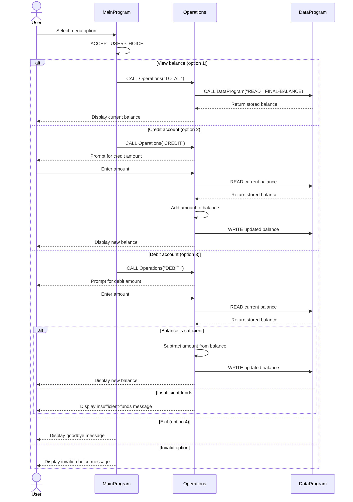

# COBOL Account Management

This directory documents the COBOL account management example in `src/cobol/`.
Despite the student-account context of the exercise, the current program models
one generic account; it does not store student identities or multiple accounts.

## Source Files

### `main.cob`

Defines the interactive entry point, `MainProgram`. It displays a menu, reads
the user's selection, and dispatches account actions to `Operations`:

- `1`: view the current balance (`TOTAL`)
- `2`: credit the account (`CREDIT`)
- `3`: debit the account (`DEBIT`)
- `4`: exit the program

Any other selection displays an invalid-choice message.
Operation names use the six-character `PIC X(6)` field, so `TOTAL` and `DEBIT`
are space-padded when passed to `Operations`.

### `operations.cob`

Defines `Operations`, which handles the requested account action. It reads the
current balance before displaying or changing it, prompts for an amount for
credits and debits, and writes the updated balance after a successful change.
For debits, it displays an insufficient-funds message instead of applying a
withdrawal when the balance is less than the requested amount.

### `data.cob`

Defines `DataProgram`, the balance storage interface. `READ` copies the stored
balance to the caller, while `WRITE` replaces it with the caller-provided
balance. The stored balance starts at `1000.00` and is held in the program's
working storage; there is no file or database persistence in this code.

## Account Rules and Limits

- The example maintains a single account balance, initialized to `1000.00`.
- A credit adds the entered amount to the balance.
- A debit is applied only when the current balance is at least the entered
  amount; otherwise, the balance is left unchanged and an insufficient-funds
  message is shown.
- Balances and transaction amounts use `PIC 9(6)V99`, allowing six integer
  digits and two implied decimal places.
- The code does not validate that entered amounts are positive, identify or
  authenticate a student, distinguish among student accounts, or persist data
  outside the running program. No additional student-specific rules are
  implemented.

## Application Sequence

